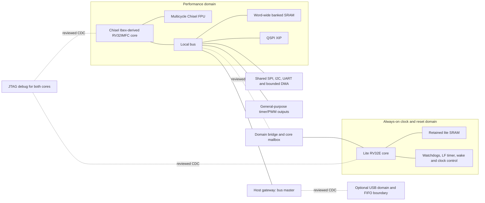

# 03 Architecture

D69 update: references to the actuator resource mean a provisional generic
timer/PWM output resource, not a flight-specific controller. Hardware provides
ordinary MCU primitives; firmware owns protocol encoding and command/failsafe
policy. Resource names/windows and existing RTL are not renamed by this update.

The initial MCU is entirely clocked Chisel. The approved choices are in
[10-decisions-and-risks.md](10-decisions-and-risks.md); physical feasibility
and clock frequency remain subject to measurement. No neuromorphic IP or
chip-to-chip link is included.

## Block view

## Cores and memories

The performance core is a Chisel conversion of a pinned Ibex revision, with
full RV32IMFC, machine-mode CSRs, vectored interrupts, `wfi`, debug and an RVFI
verification path. The unmodified Ibex SystemVerilog is kept under
`hw/vendor/ibex_ref/` as a reference only: the conversion is first proved
equivalent to it module by module as RV32IMC with no changes (T10/T11), and
only then is F integrated and anything improved (T12/T13). The chip does not
contain an Ibex SystemVerilog BlackBox and no alternative-core selection is
requested. Improvements should target GF180 area, timing and clock gating
without reducing ISA correctness. Their benefits must be measured.

The FPU is area-focused and multicycle, selectively reusing pinned HardFloat
Chisel components. Full F semantics include rounding modes, flags, fused
operations, subnormals, special values, comparisons and conversions. D is
excluded. Ibex has no F extension, so the FPU and its integration are new
design outside the equivalence proof and need their own verification.

RISCay's clocked RV32E core becomes the lite core with minimal interrupts/CSRs,
`wfi`, debug and local or bridged bus access. The historical D18 Click option is deferred
to a separate explicitly authorized brief; no async dependency enters this build.

Performance SRAM baseline is 16 KiB with word-wide access, byte-write enables
and configurable banks. Lite SRAM baseline is 3 KiB retained. Macro access
latency and any capacity increase require measurement; word-wide does not imply
single-cycle access. Cold code uses QSPI XIP; loop-critical code stays in SRAM.

## Buses and ownership

Local request/response buses retain byte masks and explicit errors. Decode is
generated from register descriptions. Fetches and local SRAM/actuator accesses
never cross a clock domain. There is no NoC (D43). Each clock domain has one
bus using the Ibex memory interface signals. A reviewed domain bridge carries
single transactions between the always-on and main domains, and must wake a
stopped clock rather than lose a request. A two-way mailbox carries messages
between the cores. The host gateway is a bus master with the same checks as
any other master. One address window and one interrupt are reserved for a
future NoC bridge. T14 specifies and builds the fabric, bridge and mailbox.

| Resource | Access policy |
| --- | --- |
| Performance SRAM, XIP and actuator registers | Performance-local; authorized debug/programming access |
| Lite SRAM, wake, clock and reset control | AON-local; checked remote access |
| SPI, I2C controller, UARTs | One programmable owner at a time; ownership checked at the endpoint for local, remote and DMA requests |
| Frozen I2C recovery loader | Lite/AON baseline, checked remote access; dedicated ADC retired by D74 |
| USB FIFO interface | Gateway subsystem, checked access from both cores |

Ownership transfer must drain or cancel outstanding transfers before granting
the next owner. DMA inherits the requesting owner's peripheral and memory
permissions; it cannot bypass private-memory checks. DMA serves SPI/UART using
bounded bursts and completion/error interrupts; no linked descriptors initially.

## Clock, reset and sleep boundaries

Logical clock domains include AON, main/HF, optional USB, and JTAG TCK.
Shared peripherals can remain clocked while the performance core sleeps;
core-only reset preserves peripherals serving surviving owners. Generic PWM
reset and output-disable behavior belongs in its peripheral contract (D69),
without dedicated actuator failsafe state. Final domain partitioning
must be documented at G1. Do not assert an artificial total of two crossings:
all asynchronous crossings instantiate the same reviewed CDC implementation.

Under D78, AON uses the on-die nominal 32 kHz LF RC oscillator. AON_CLK_SEL
selects fallback AON_CLK_IN while reset is held; selection is fixed after
release. External 48 MHz CMOS OSC_IN directly clocks USB; a registered
divide-by-six supplies main at 8 MHz. There is no internal HF oscillator or
AON fast-service mode in this tapeout. Existing shared CDC remains even between
related main and USB clocks. OSC_EN controls external oscillator standby and
is high during reset, with a board pull-up. No runtime switching or automatic
failover is implied.

On-die POR/brownout and the external active-low pin hold ordinary domains in
reset (D79). POR_BYPASS permits pin-only recovery from a faulty analog macro.
Release order is supply/pin qualification, running AON clock and counted AON
stability, AON release, lite boot, verified external-clock startup, then main
release. Domain release does not implement autonomous lite boot: until T36,
the existing recovery-loader START and boot-release paths remain authoritative.

Retained sleep gates the performance core. Selected SPI/I2C/UART operations may
request HF without waking it; stop HF only after all consumers release their
requests and transactions drain. UART receive mode can keep HF running;
wake-only mode may lose the first byte. Timer, event and JTAG wake are supported.
Wake requests must be observable while destination clocks are stopped.
D81 keeps OSC_EN high whenever USB is enabled; attached USB resume uses light
sleep. Oscillator-off sleep requires USB disabled (and therefore detached) and takes the
external part's millisecond startup plus stability qualification (plan06).
D82 limits frozen-loader recovery SCL to the minimum qualified AON rate / 8.

Performance watchdog resets the performance core/client epoch and disables
PWM outputs, preserving shared buses, DMA, peripherals and AON state (D70).
Lite watchdog, POR and brownout reset the MCU. Generic watchdog/reset and
output-disable mechanisms provide hardware fault handling; firmware and the
board define application-specific failsafe behavior (D69). Whole-chip reset
disables outputs. Existing stub reset wiring remains unchanged until a scoped
generic peripheral implementation defines its reset contract. See
[06-power-clock-reset.md](06-power-clock-reset.md).

## Pins and optional USB

Limited register-selectable alternate functions, not an arbitrary crossbar.
External clock/reset and JTAG retain dedicated pins; general-purpose outputs
start disabled. Freeze a map allowing all baseline interfaces simultaneously.

USB CDC-ACM uses TX/RX byte FIFOs, status/control, interrupts and wake through
reviewed CDC. The identical-port stub is replaced only after implementer
verification and physical requirements are available. UART/JTAG remain the
fallback before the Phase 3 floorplan-freeze cutoff.
