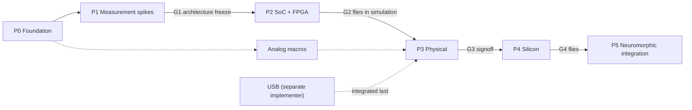

# 09 Roadmap

Phases are ordered by dependency and each ends at a gate. No dates are given:
they depend on team size and shuttle schedule, which this plan does not know
(open question Q3).

Deadhorse is entirely clocked (decision D17). The clockless plan had a phase
that generated an asynchronous design from the clocked one, and a mutex
qualification track; both are removed. The RTL built in Phase 2 is the RTL
that tapes out.

One track starts in Phase 0 and runs in parallel because it has the longest
lead time and gates signoff: **analog macro layout**.

## P0 Foundation

1. Approve or amend the decisions in
   [10-decisions-and-risks.md](10-decisions-and-risks.md), at least D1 and
   D2, which shape everything else.
2. Done: the flight-loop measurement is in `sw/flight/loop-measurement/` and
   reproduces from there. Task T02 puts it under CI.
3. Set up the repository skeleton, CI, the Chisel build, and the one-time
   import of RISCay's clocked design (per D1).
5. Confirm the nine-channel split against the Stallion wiring PDF and pick
   the sensor parts (IMU, barometer, compass, airspeed, GPS, receiver).
6. Start the analog track.
7. Agree the USB integration contract with its implementer: boundary,
   reserved area, pads, clock, deliverables and cut-off
   ([07-peripherals-memory-boot.md](07-peripherals-memory-boot.md)).

### Repository layout

The layout and its rules are in
[11-repository-structure.md](11-repository-structure.md). Phase 0 creates the
top-level directories, the block template and the structure check in CI.

**Gate G0:** decisions D1 and D2 recorded; USB integration contract agreed;
skeleton and CI in place.

## P1 Measurement spikes

Briefs for the Phase 0 tasks and for these spikes are in
[tasks/README.md](tasks/README.md).

Four short, parallel investigations. Each produces a number that replaces an
assumption in [02-requirements.md](02-requirements.md) or
[08-physical-verification.md](08-physical-verification.md). No production RTL
is written.

| Spike | Question | Method | Output |
| --- | --- | --- | --- |
| **S1 Core** | How fast and how large is the performance core on GF180? | Map Ibex (and the extended RISCay core as a control) to the chosen library; run static timing at the slow corner; run the measured flight-loop binary cycle-accurately for cycles per instruction; try the SRAM word-access options | Area, maximum clock frequency, cycles per instruction, instructions per second at the slow corner |
| **S3 Memory** | Is 16 KiB of SRAM plus execute-in-place enough? | Build a skeleton firmware with real drivers and the measured loop; produce the hot and cold split; model flash fetch cost | Hot-set size, in-place execution rate, SRAM size recommendation |
| **S4 Latency and test** | What are interrupt latency, and scan coverage in the open flow? | Measure pin-to-handler latency on the candidate core in cycles; insert scan on one block with the chosen library and generate patterns | Latency bound; scan overhead and coverage |

**Gate G1, architecture freeze.** Proceed if S1 shows at least 5 MIPS at the
slow corner. Between 2.5 and 5 MIPS, proceed at a 500 Hz loop and record the
shortfall. Below 2.5 MIPS, stop and revisit the core choice. At G1 the main
clock frequency, area budget, pad budget and clock-domain boundaries are
frozen.

## P2 SoC and FPGA prototype

Build the whole system in Chisel. This is the production RTL.

1. Import RISCay's clocked design as the always-on domain; add the second
   clock domain, the clock mux and gates, and the crossing block.
2. Integrate adopted blocks on the local bus with the generated register map.
3. Write the new blocks: actuator block, timers, serial peripherals,
   lite-core extensions.
5. Boot chain with two images; gateway monitor over UART. USB is a stub with
   its final ports.
6. FPGA build. Flight firmware against a hardware-in-the-loop airframe
   simulation; then real ESCs, servos and sensors on the bench.
8. Insert scan and run the suite on the gate-level netlist.

9. **Optional, after the lite core is stable (decision D18):** build the
   coarse Click version of the lite core as spike S5. Map it, size its
   matched delays at every corner, check that it idles with no activity, and
   run the shared lite-core tests on it. Compare area, energy per task and
   wake latency with the clocked version. Decide before the Phase 3
   floorplan freeze which one tapes out; the clocked version is the default.

**Gate G2.** The SoC on FPGA flies the simulated Stallion through hover,
transition and forward flight; drives nine real actuators with correct
timing; enters and leaves deep sleep with the main clock really stopped. The structural CDC check is clean.

## P3 Physical

1. Floorplan with SRAM, analog macros and pad ring.
2. Synthesis, scan insertion, placement, clock-tree synthesis, routing, in
   Coldfoot's LibreLane flow.
3. Timing closure at all corners with extracted RC.
4. Integrate analog macro layouts; full-chip DRC, LVS, antenna.
5. Extracted leakage for the deep-sleep estimate.
6. **Integrate USB last,** into its reserved region, and rerun the suite with
   the USB tests added. If it misses the floorplan freeze, apply the cut-off:
   fill the region, tie off the pads, keep the UART gateway.

**Gate G3.** All ten signoff gates in
[08-physical-verification.md](08-physical-verification.md).

## P4 Silicon

1. Tape out on the GF180 shuttle.
2. Bring-up board: flash, 48 MHz oscillator, sensors, connectors for nine
   actuators and USB.
3. Production test program from D8; trim and calibration flow.
4. Characterise: maximum clock frequency over voltage and temperature,
   deep-sleep current, oscillator accuracy, wake latency.
5. Flight: bench, tethered hover, free hover, transition.

**Gate G4.** The definition of done in
[01-product-definition.md](01-product-definition.md).

## P5 Neuromorphic integration (separate plan)

Future integration requires a separate plan.

## What can start now

Independent of every open decision: the repository skeleton, the flight-loop
CI task, the register-map generator,
the airframe simulation model, and the oscillator track.
