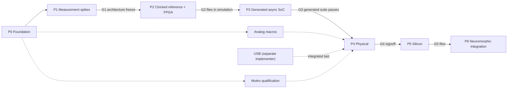

# 09 Roadmap

Phases are ordered by dependency and each ends at a gate. No dates are given:
they depend on team size and shuttle schedule, which this plan does not know
(open question Q3).

Two tracks start in Phase 0 and run in parallel because they have the longest
lead time and gate signoff: **analog macro layout** and **mutex
qualification**.

## P0 Foundation

1. Approve or amend the decisions in
   [10-decisions-and-risks.md](10-decisions-and-risks.md), at least D1 and
   D2, which shape everything else. D10 is already approved.
2. Done: the flight-loop measurement is in `sw/flight/loop-measurement/` and
   reproduces from there. Task T02 puts it under CI.
3. Set up the repository skeleton below, CI, and the pinned dependency on
   RISCay-MCU's generator (per D1).
5. Confirm the nine-channel split against the Stallion wiring PDF and pick
   the sensor parts (IMU, barometer, compass, airspeed, GPS, receiver).
6. Start the analog and mutex tracks.
7. Agree the USB integration contract with its implementer: boundary,
   reserved area, pads, clock, deliverables and cut-off
   ([07-peripherals-memory-boot.md](07-peripherals-memory-boot.md)).

### Repository layout

The layout and its rules are in
[11-repository-structure.md](11-repository-structure.md). Phase 0 creates the
top-level directories, the block template and the structure check in CI.

**Gate G0:** decisions D1 and D2 recorded; USB integration contract agreed;
skeleton and CI in place.

## P1 Measurement spikes

Briefs for the Phase 0 tasks and for these spikes are in
[tasks/README.md](tasks/README.md).

Four short, parallel investigations. Each produces a number that replaces an
assumption in [02-requirements.md](02-requirements.md) or
[08-physical-verification.md](08-physical-verification.md). No production RTL
is written.

| Spike | Question | Method | Output |
| --- | --- | --- | --- |
| **S1 Core** | Can the performance core reach 5 MIPS desynchronized on GF180? | Map Ibex (and the extended RISCay core as a control) to GF180; run both through the generator; model recurrence at five corners; run the measured flight-loop binary cycle-accurately for cycles per instruction; try the SRAM word-access options | Area, bank count, recurrence, cycles per instruction, instructions per second at the slow corner |
| **S3 Memory** | Is 16 KiB of SRAM plus execute-in-place enough? | Build a skeleton firmware with real drivers and the measured loop; produce the hot and cold split; model flash fetch cost | Hot-set size, in-place execution rate, SRAM size recommendation |
| **S4 Latency and test** | What are interrupt latency and the cost of test access? | Measure pin-to-handler latency on the candidate core in simulation with slow-corner delays; prototype the latch-enable test override on one bank | Latency bound; added control area for test mode |

**Gate G1, architecture freeze.** Proceed if S1 shows a credible route to 5
MIPS. If it shows 2.5 to 5 MIPS, proceed at a 500 Hz loop and record the
shortfall. Below 2.5 MIPS, stop and revisit the core or the desync
partitioning before anything else is built. At G1 the area budget, pad
budget, region boundaries and clocked-state ceiling are frozen.

## P2 Clocked reference SoC and FPGA prototype

Build the whole system clocked, because that is the input to the generator
and the fastest way to find integration problems.

1. Integrate adopted blocks on the local bus with the generated register map.
2. Write the new blocks: actuator block, timers, lite-core extensions.
4. Boot chain with two images; gateway monitor over UART. USB is a stub with
   its final ports.
5. FPGA build. Flight firmware against a hardware-in-the-loop airframe
   simulation; then real ESCs, servos and sensors on the bench.

**Gate G2.** The clocked reference on FPGA flies the simulated Stallion
through hover, transition and forward flight; drives nine real actuators
with correct timing; enters and leaves deep sleep (emulated by clock gating).

## P3 Generated async SoC

1. Define regions A and M and their banks; generate.
2. Region crossings (A to M, M to T, M to U) with their synchronizers.
3. Run the full suite on the generated design with slow-corner modelled
   delays and randomised delays.
4. Close every deadline in the throughput table.
5. Ledger: area ratios, clocked storage per clock, control share.

USB remains a stub through G3.

**Gate G3.** Every test that passes on the reference passes on the generated
design at the slow corner, with no weakened assertion. Ratios within R-PHY-3.

## P4 Physical

1. Floorplan with SRAM, analog macros and pad ring.
2. Synthesis, electrical repair, placement, routing for regions and islands.
3. Relative-timing closure per bank at all corners with extracted RC; routed
   hold repair on failing paths only.
4. Integrate analog macro layouts; full-chip DRC, LVS, antenna.
5. Extracted leakage for the deep-sleep estimate.
6. **Integrate USB last,** into its reserved region, and rerun the suite with
   the USB tests added. If it misses the floorplan freeze, apply the cut-off:
   fill the region, tie off the pads, keep the UART gateway.

**Gate G4.** All ten signoff gates in
[08-physical-verification.md](08-physical-verification.md).

## P5 Silicon

1. Tape out on the GF180 shuttle.
2. Bring-up board: flash, 48 MHz oscillator, sensors, connectors for nine
   actuators and USB.
3. Production test program from D8; trim and calibration flow.
4. Characterise: speed over voltage and temperature, deep-sleep current,
   oscillator accuracy, wake latency.
5. Flight: bench, tethered hover, free hover, transition.

**Gate G5.** The definition of done in
[01-product-definition.md](01-product-definition.md).

## P6 Neuromorphic integration (separate plan)

Future integration requires a separate plan.

## What can start now

Independent of every open decision: importing the flight-loop measurement,
the repository skeleton, the register-map generator, the airframe simulation model,
and the mutex and oscillator tracks.
